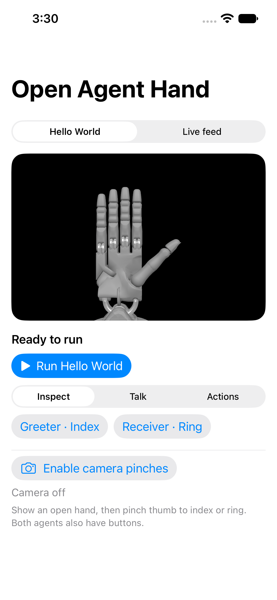
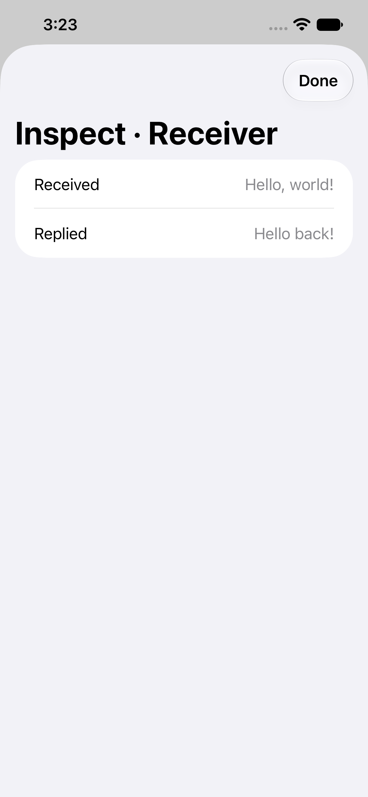

# Open Agent Hand

A gesture interface for inspecting and directing agents on macOS and iOS. Each finger can show an agent's state. Pinching selects an agent, and the app shows the message or event before you choose what to do.

 

*iPhone simulator captures of the offline Hello World demo. The Receiver card was opened with the on-screen button.*

## Run the demo

Use Xcode 16 or later with XcodeGen. The app builds for macOS 15 and iOS 18 or later. Open the generated project and choose the Mac or iOS scheme. A physical iPhone needs a development team selected in Xcode.

```sh
xcodegen generate
open OpenAgentHand.xcodeproj
swift test
```

In **Hello World**, tap **Run Hello World**. Greeter sends “Hello, world!” and Receiver answers “Hello back!” Everything in this example runs offline.

- **Inspect** shows the message and reply. **Talk** opens a composer you can type or dictate into, and **Send message** invokes the selected offline agent. **Actions** opens controls to rerun or clear the exchange.
- Choose **Enable camera pinches** on the Mac or iPhone. Show one open hand to arm the recognizer. Bring your thumb to your index finger for Greeter or to your ring finger for Receiver and hold briefly. Release before making another selection.
- **Mirror my hand** shows detected finger bends. Turn it off to see agent states on the robot. You can also tap or click an agent's button. The iOS simulator supports buttons and replay.

Camera frames are processed by Vision on the device. The app uses one hand's joints and discards the frames. It never saves or streams camera video.

## Watch a real event feed

The Python 3 bridge keeps up to 200 events in memory. Start it in one terminal. If you supply a token in the environment, use that token for the app and producer. Otherwise the server prints a fresh session token.

```sh
python3 tools/bridge.py serve
```

In another terminal, set `OPEN_AGENT_HAND_TOKEN` to the same session token, then explicitly run one of the producers. The Codex relay uses a configured Codex CLI and two read-only turns. The Threadmark adapter uses an installed `threadmark-mcp` to read up to five public GitHub stars from a chosen account.

```sh
python3 tools/bridge.py codex-relay
python3 tools/bridge.py threadmark <github-login>
```

Use **Live feed** in the app and connect to `http://127.0.0.1:8672` on the Mac or iOS simulator. On a physical iPhone, use a trusted private network and the Mac's `http://<hostname>.local:8672` address with `serve --bind 0.0.0.0`, or use an HTTPS endpoint. The optional private-network HTTP route sends the short-lived token in cleartext. Producer writes are accepted only on the bridge's loopback interface. Stop the bridge after use.

Pinch thumb to a fingertip or choose an agent to inspect the event. The thumb role has a button. **Replay** steps through the received events. The live feed view reads event summaries. Talk and Actions are available in the offline demo. The bridge sends a fixed set of event labels and keeps raw prompts, tool arguments, and output off the feed.

### Add a producer

The app reads `GET /v1/events` with an authorization bearer token. Serve an `AgentSnapshot` with a UUID `runID` and up to 200 ordered events. Each event has an increasing positive `id`, an `agent` role, a `phase` and a short `detail`. Use a new run ID when replacing a run. The Swift package supplies the schema and maps it to finger poses. See [AgentInteraction.swift](Sources/OpenAgentHandCore/AgentInteraction.swift).

## License

The project is Apache-2.0. The converted Shadow Hand asset is from MuJoCo Menagerie and retains its upstream license. See [LICENSE](LICENSE) and [NOTICE](NOTICE).
